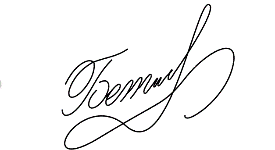

**ТЕХНИЧЕСКОЕ ЗАДАНИЕ**

**на разработку 2D-игры «CHOPPER»**

Дата: 09.11.2026

# 1. Общие сведения

## 1.1. Название проекта

Разработка 2D-игры под названием «CHOPPER».

## 1.2. Обоснование проекта

Проект инициирован с целью создания атмосферной пиксельной 2D-игры в жанре экшен-платформера с элементами исследования. Игра должна сочетать динамичный геймплей, простую, но цепляющую механику боя и сильную атмосферу мрачного леса. Основной ориентир по ощущениям и стилю — игра Hollow Knight, адаптированная под уменьшенный масштаб карты и более короткую, сфокусированную сессию прохождения. Визуальный стиль — пиксельная графика.

## 1.3. Заказчик и исполнитель

Заказчик: Bruce Wayne

Исполнитель: Guts Born

Исполнителем выступает: специализированная компания по разработке информационных систем Игорь_Команда_РПО/КБ.

## 1.4. Сроки реализации

Начало работ: 01.09.2026

Окончание работ: 31.12.2026

## 1.5. Платформа

Игра разрабатывается исключительно для операционной системы Windows (Windows 10 и выше). Поддержка других платформ не требуется.

# 2. Цели и задачи проекта

## 2.1. Цель проекта

Создание законченной пиксельной 2D-игры «CHOPPER» — атмосферного экшен-платформера с уменьшенной картой, в котором игрок управляет дровосеком-канадцем, пробирается через опасный огромный лес, сражается с ожившими кустами и деревьями и должен добраться до дома.

## 2.2. Основные задачи

- Разработать геймплей в духе Hollow Knight с уменьшенной картой.

- Реализовать управление персонажем, систему здоровья и боя.

- Создать двух типов врагов: Куст и Дерево с уникальными способностями.

- Построить линейную или слегка разветвлённую карту огромного леса с конечной точкой — домом.

- Обеспечить сильную атмосферу (туман, освещение, звук, пиксельный визуальный стиль).

- Собрать и протестировать игру под Windows.

# 3. Описание игры и игрового процесса

## 3.1. Концепция

«CHOPPER» — это пиксельная 2D-игра от третьего лица (вид сбоку), вдохновлённая Hollow Knight. Карта значительно меньше, чем в оригинале, и рассчитана на более короткое, но насыщенное прохождение. Игрок управляет дровосеком-канадцем, который заблудился в лесу из-за сильного тумана. Причина происходящего — он рубил деревья, и теперь лес «ожил» и пытается ему помешать.

Главная цель игрока — дойти до конца карты, где находится его дом. По пути необходимо сражаться с враждебными кустами и деревьями.

**Референсы:** Don't Starve Together (для персонажа-дровосека); мультик «Добрыня Никитич и Змей Горыныч» (для деревьев); водоросли из Plants vs Zombies (для куста); локация — гигантский лес.

## 3.2. Главный герой

**Образ:** Дровосек в виде канадца.

**Внешний вид:** Красная клетчатая рубашка, синие джинсы, шапка.

**Роль:** Игровой персонаж, управляемый игроком.

**Краткая предыстория:** Приехал в опасную зону, чтобы подзаработать, рубил деревья, что стало причиной агрессии леса, позже потерялся в лесу из-за тумана.

## 3.3. Враги

В игре присутствуют два основных типа врагов:

- **Куст** — из куста выходят ёжики, которые атакуют игрока.

- **Дерево** — кидается ульем и жёлудем.

**Способности врагов:**

- Куст выпускает ёжиков.

- Дерево бросает улей и жёлудь.

Поведение врагов: активно ищут игрока, приближаются к нему и атакуют при сближении. Цель врагов — не дать игроку добраться до дома.

**Секретный босс:** предусматривается возможность добавления секретного босса (детали уточняются на этапе проектирования).

## 3.4. Локация

Основная локация — огромный (гигантский) лес. На заднем плане размещаются объекты, похожие на врагов (кусты и деревья), но без глаз — для усиления атмосферы «живого» и враждебного леса.

В конце карты расположен дом — конечная точка. Возможны небольшие ответвления и секретные зоны.

## 3.5. Цель и условия победы/поражения

**Победа:** игрок доходит до конца карты и достигает дома.

**Поражение:** здоровье персонажа опускается до нуля.

# 4. Функциональные требования

## 4.1. Управление персонажем

Необходимо реализовать классическое 2D-управление:

- Движение влево / вправо

- Прыжок

- Атака (ближний бой)

- Возможность приседания / уклонения (по возможности)

Управление осуществляется с клавиатуры (рекомендуемая раскладка: WASD + пробел + клавиша атаки). Поддержка геймпада — желательна, но не обязательна на первом этапе.

## 4.2. Система здоровья и боя

• У персонажа есть шкала здоровья.

• При получении урона от врагов здоровье уменьшается.

• При достижении нуля здоровья — экран поражения и возможность начать заново.

• Атака персонажа наносит урон врагам. После получения определённого количества урона враг уничтожается.

## 4.3. Карта и уровни

• Карта уменьшенная (значительно меньше типичной карты Hollow Knight).

• Основная структура — лесная локация (огромный лес) с элементами платформинга.

• В конце карты расположен дом — конечная точка.

• Возможны небольшие ответвления и секретные зоны, но основной путь должен быть понятным.

## 4.4. Атмосфера и оформление

• Визуальный стиль: пиксельная графика, мрачный атмосферный лес, туман.

• На заднем плане — силуэты/объекты, похожие на врагов, но без глаз.

• Важное значение имеет освещение и эффекты тумана.

• Звуковое сопровождение: фоновая музыка и звуки леса, атаки, шагов, ударов.

• Общая атмосфера должна создавать ощущение опасности и изоляции.

## 4.5. Интерфейс

• Отображение текущего здоровья персонажа (хп).

• Главное меню (старт игры, выход).

• Экран победы и экран поражения.

• Пауза во время игры.

# 5. Нефункциональные требования

## 5.1. Производительность

Игра должна стабильно работать на средних конфигурациях ПК под Windows 10/11 с частотой кадров не ниже 60 FPS в обычных условиях.

## 5.2. Совместимость

Целевая платформа — Windows 10 и Windows 11. Разрешение экрана: поддержка популярных разрешений (от 1280×720 и выше), с возможностью выбора оконного и полноэкранного режима.

## 5.3. Удобство использования

Управление должно быть отзывчивым и интуитивно понятным. Кривая обучения — минимальная. Игрок должен быстро понять основные механики.

# 6. Технические требования и рекомендации

Рекомендуемый стек (может быть уточнён исполнителем):

- Движок: Unity (рекомендуется) или Godot

- Язык: C# (при использовании Unity) или GDScript/C# (Godot)

- Графика: 2D-пиксельные спрайты, тайловые карты

Итоговая сборка должна представлять собой исполняемый файл (.exe) + необходимые библиотеки, запускаемый на Windows без дополнительной установки сложного окружения.

# 7. Этапы разработки

1.  **Проектирование и уточнение механик** — согласование точного списка механик, баланса здоровья/урона, структуры карты, деталей секретного босса (при наличии).

2.  **Прототип** — движение персонажа, базовый прыжок, одна тестовая локация, один тип врага.

3.  **Основная разработка** — оба типа врагов (Куст и Дерево) с их способностями, полная карта, система здоровья, боевая система, атмосфера (туман, свет, звук, пиксельный стиль).

4.  **Полировка и баланс** — настройка сложности, исправление багов, улучшение отзывчивости управления.

5.  **Финальная сборка и сдача** — подготовка релизной версии под Windows, передача заказчику.

# 8. Порядок приёмки

Приёмка проводится поэтапно:

- Проверка прототипа (движение + базовый бой).

- Проверка полной версии (оба типа врагов с способностями, карта, дом, атмосфера).

- Финальная приёмка после устранения замечаний.

Критерий готовности: игра запускается на Windows, все заявленные механики работают, цель (дойти до дома) достижима, атмосфера и пиксельный стиль соответствуют описанию.

# 9. Дополнительные замечания

Данное техническое задание описывает минимально необходимый функционал для создания законченной версии игры. По согласованию сторон могут быть добавлены:

- Система сохранений

- Дополнительные типы врагов, ловушки или секретный босс

- Улучшения персонажа / простая прокачка / альтернативные скины (включая вариант в трусах)

- Более сложная структура карты

Все существенные изменения должны оформляться дополнительно и согласовываться с заказчиком.

**Заказчик:** Bruce Wayne /

**Исполнитель:** <u>Guts Born/</u>

Дата: «\_\_<u>06</u>\_\_» \_\_<u>ноября</u>\_\_ 2026 г.
